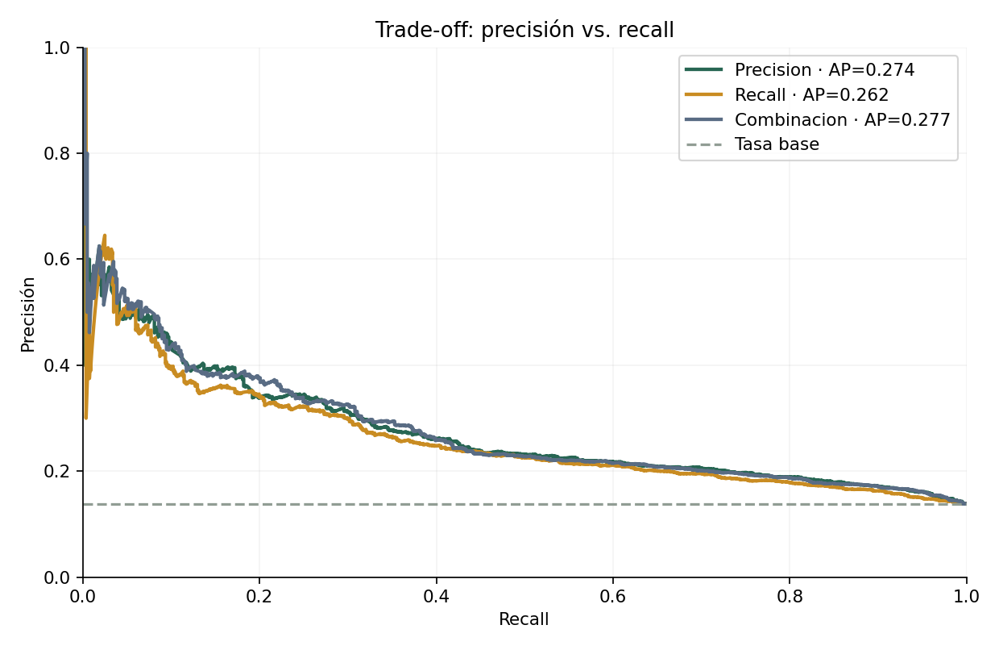
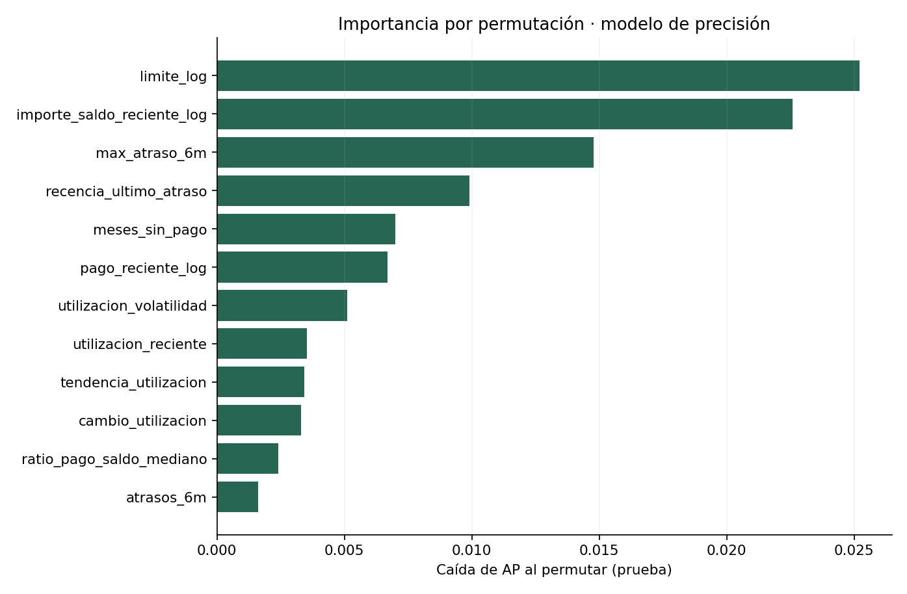
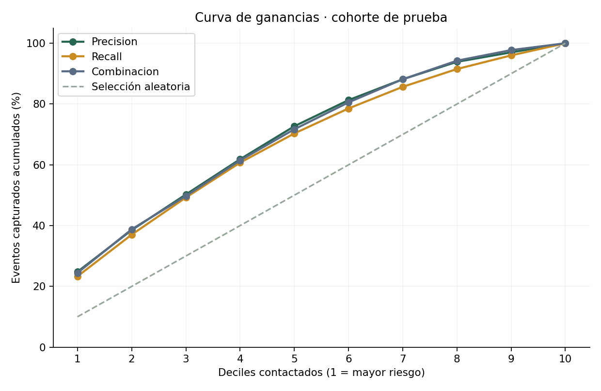
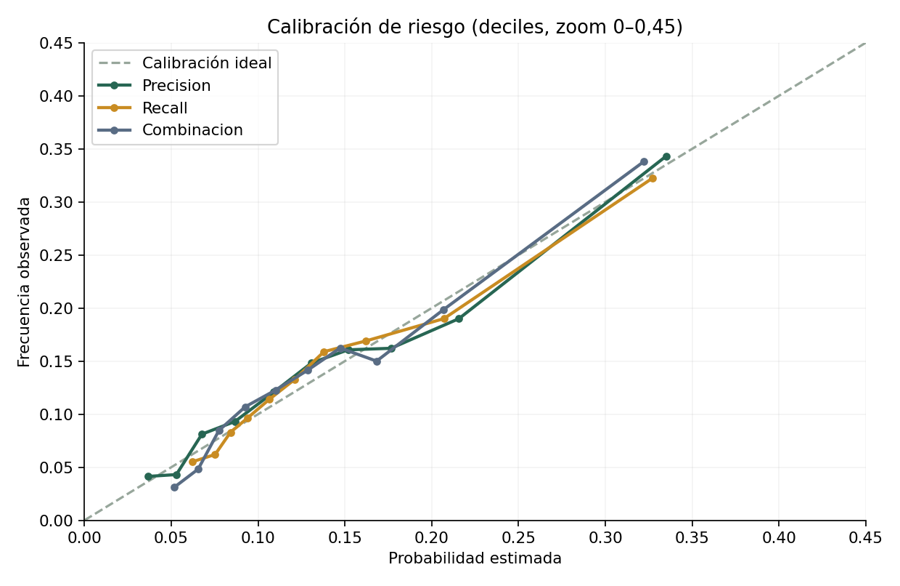

# Alerta temprana de cartera

**Quórum Risk · Caso demostrativo técnico de inteligencia de cartera**

> ⚠️ **DATOS PÚBLICOS, NO DE CLIENTES.** Este caso utiliza el dataset académico *Default of Credit Card Clients* (UCI, Taiwán, 2005). Los resultados de esta página **no pertenecen a clientes, no miden impacto comercial y no representan desempeño en producción**.

## La decisión importante ocurre antes de elegir un algoritmo

**¿A quién deberíamos dar seguimiento antes de que aparezca un problema de pago?** La pregunta parece técnica, pero primero exige acordar qué significa *deteriorarse*, desde qué fecha se observan los datos, a quiénes aplica la estrategia y qué decisiones tendrá que tomar el equipo.

Este repositorio documenta esas decisiones y construye **25 variables de comportamiento** a partir de seis meses de saldos, pagos y estados de pago. **No se entrena con columnas crudas, variables demográficas ni identificadores.** Después compara dos estrategias predictivas y una combinación que debe ganarse su lugar en la evaluación.



## 1. Target y población: qué predice realmente

| Decisión | Definición del ejercicio |
|---|---|
| Unidad | Cliente/tarjeta del archivo UCI |
| Observación | Abril–septiembre de 2005 |
| Corte | Septiembre de 2005 |
| Desempeño | Etiqueta oficial de *default payment next month* (mes siguiente) |
| Positivo | `1` = default reportado para el mes siguiente |
| Negativo | `0` = no default reportado para el mes siguiente |
| Exclusión preventiva | `PAY_0 > 0`: código de retraso positivo **ya observado** en septiembre |
| Indeterminados | Etiqueta ausente/no binaria o historial/cupo inválido; se excluyen |
| Limitación | `PAY_0 <= 0` no significa necesariamente *al día*: los códigos 0/-2 son ambiguos |

De las **30.000** observaciones públicas, **23.182** quedan en la cohorte sin atraso positivo registrado al cierre. Hay **3.207** eventos reportados en el mes siguiente (**13,83%**). Es una demostración de riesgo futuro dentro de esa cohorte, **no** una prueba de que se predice el primer atraso de un cliente. El dataset no proporciona fechas exactas de default ni una definición contractual de 30/60/90 días de mora.

En una consultoría real, el target, sus exclusiones y la ventana de desempeño deben **co-definirse con el negocio y validarse con las fuentes disponibles**. La decisión se explica en [Definición del target](docs/DEFINICION_TARGET.md).

## 2. Ingeniería de variables con sentido

Las columnas `PAY_*`, `BILL_AMT*` y `PAY_AMT*` se usan **solo como insumos** para generar indicadores:

| Familia | Ejemplos de variables construidas | Pregunta de negocio |
|---|---|---|
| Historia de mora | Mayor atraso, meses con atraso, recencia y tendencia | ¿Hubo señales previas aunque ahora no haya atraso positivo? |
| Utilización | Utilización reciente, pico, cambio y volatilidad | ¿Está creciendo la presión sobre el cupo? |
| Pagos | Frecuencia sin pago, ratios, volatilidad y tendencia | ¿Se están debilitando los hábitos de pago? |
| Capacidad relativa | Límite logarítmico y saldos transformados | ¿Cómo contextualizar importes y saldos? |

No interpretamos los ratios como conciliaciones contables ni la importancia predictiva como causalidad.



## 3. Tres hipótesis, no un «quórum» milagroso

Se evalúan dos modelos originales más su promedio simple:

1. **Precisión:** gradient boosting (HistGradientBoosting), con un umbral seleccionado sobre predicciones *out-of-fold* para favorecer precisión y exigir una cobertura mínima.
2. **Recall:** regresión logística regularizada, con un umbral destinado a capturar más eventos bajo una restricción mínima de precisión.
3. **Combinación:** promedio 50/50 de probabilidades, con umbral elegido por F1 en desarrollo. **No se asume que combinar mejore los resultados.**

Las estrategias utilizan **modelos y umbrales distintos**; por eso deben compararse tanto las métricas de ranking (ROC AUC, PR AUC, KS) como la precisión/recall a su umbral operativo, el volumen de clientes contactados, las ganancias y la calibración.

### Resultados medidos (muestra de prueba reservada)

| Estrategia | ROC AUC | PR AUC (AP) | KS | Precisión | Recall | Lift primer decil |
|---|---:|---:|---:|---:|---:|---:|
| Precisión | 0,687 | 0,274 | 0,270 | **39,2%** | 14,0% | **2,48×** |
| Recall | 0,667 | 0,262 | 0,243 | 21,3% | **57,0%** | 2,33× |
| Combinación | 0,685 | **0,277** | 0,259 | 22,1% | 53,4% | 2,44× |

**Lectura honesta:** la combinación obtiene la AP más alta observada, pero supera al gradient boosting por aproximadamente **0,0023 puntos**; esa diferencia es pequeña y **no demuestra superioridad estadística ni económica**. El modelo de precisión prioriza una lista corta; el de recall captura más casos a costa de muchos más contactos. El mejor depende del costo de intervenir, la capacidad y los objetivos del negocio.

Las métricas completas —incluidos F1, Brier, tasas de contacto y matrices de confusión— están en [métricas](reports/metricas.json) y [resumen reproducible](reports/resumen.md). La [tabla de lift](reports/tabla_lift.csv) contiene los diez deciles por estrategia.




## 4. Validación sin fingir una prueba temporal

Este dataset contiene una **única fotografía histórica para los 30.000 clientes**. Por ello, ordenar filas por ID no genera una evaluación *out-of-time* válida.

- **25% de prueba final**, seleccionado de forma estratificada y reservado hasta el final.
- **75% para desarrollo**, con validación cruzada estratificada de **4 folds**.
- Umbrales elegidos usando **solo probabilidades out-of-fold** de desarrollo; sin reoptimización en prueba.
- Evaluación adicional de **calibración (Brier y curva por deciles)** y **lift por deciles**.
- Importancia por permutación en prueba: diagnóstico explicativo posterior, **no criterio para reajustar el modelo**.

## 5. Reproducir desde cero

Requisitos: Python 3.10+ y conexión a internet para descargar el archivo original de UCI la primera vez.


```bash
python -m venv .venv
python -m pip install -r requirements.txt
python run_demo.py
python -m unittest discover -s tests -v
```

El script descarga directamente la fuente UCI, guarda el ZIP en `data/` (ignorado por Git), prepara la cohorte, construye variables, ejecuta modelos, valida y genera `reports/` con métricas y gráficos. **No se redistribuye el dataset en este repositorio.** Semilla fija: `42`.

```text
.
├── README.md
├── run_demo.py                  # Pipeline reproducible completo
├── requirements.txt
├── docs/DEFINICION_TARGET.md    # Ventanas, exclusiones y leakage
├── tests/test_pipeline.py       # Pruebas unitarias sin internet
└── reports/
    ├── resumen.md
    ├── metricas.json
    ├── tabla_lift.csv
    ├── importancia_variables.csv
    └── figures/                 # Cuatro gráficos basados en resultados reales
```

## 6. Límites antes de una implementación real

Sin backtesting temporal, revisión exhaustiva de fuga de información, validación por negocio, simulación de costos/capacidad, evaluación de sesgos, PSI/drift, recalibración y monitoreo, **no sería responsable desplegar este enfoque para decidir sobre clientes**. Aquí no se estima reducción de mora, recuperaciones ni ROI.

## Datos, crédito y licencia

**Fuente:** I-Cheng Yeh (2009). *Default of Credit Card Clients*. UCI Machine Learning Repository. DOI: [10.24432/C55S3H](https://doi.org/10.24432/C55S3H). Ficha oficial: [UCI #350](https://archive.ics.uci.edu/dataset/350/default+of+credit+card+clients).

**Licencia del dataset:** [Creative Commons Attribution 4.0 International (CC BY 4.0)](https://creativecommons.org/licenses/by/4.0/). Este proyecto cita a su autor y dataset. La licencia indicada corresponde a los **datos UCI**, no es una declaración sobre una licencia de código. El código de análisis fue elaborado originalmente para Quórum Risk; no se copió ni se rebrandeó un notebook de terceros.

**Contacto:** [contacto@quorumrisk.co](mailto:contacto@quorumrisk.co) · [quorumrisk.co](https://quorumrisk.co)
