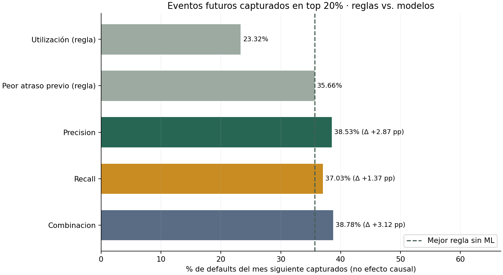

# Quórum Risk. Priorizar el seguimiento de cartera

Nota: este caso usa datos públicos de UCI, no información de clientes. Trabajamos con *Default of Credit Card Clients*, una muestra de Taiwán de 2005. Las métricas son de un ejercicio académico; no reflejan resultados comerciales, reducción real de impagos ni desempeño en producción. El repositorio conserva el nombre `alerta-temprana-cartera`, pero no demuestra una alerta temprana validada a lo largo del tiempo. Su evaluación es transversal.

## De qué trata

¿A qué cuentas conviene dar seguimiento si hoy no registran un código positivo de atraso, pero algunas incumplirán el mes siguiente? Esa es la pregunta de este caso.

Tomamos el comportamiento disponible entre abril y septiembre de 2005, construimos variables de pagos y utilización y estimamos la probabilidad del evento que el dataset reporta para el mes siguiente. Antes de decidir si merece la pena usar un modelo, lo comparamos con reglas sencillas que un equipo puede aplicar sin ML.

## Qué encontramos al compararlo con una regla sencilla

La mejor regla sin modelo ordena por el peor atraso de los seis meses anteriores y desempata por utilización. Al revisar el 20 por ciento de las cuentas, esa regla concentra el 35,66 por ciento de los defaults del mes siguiente. La combinación de modelos llega a 38,78 por ciento, 3,12 puntos por encima. Ordenar solo por utilización captura 23,32 por ciento.

La diferencia existe en este conjunto de prueba, pero no sabemos si se mantendría en otro período. Tampoco prueba que gestionar esas cuentas evite los impagos. Con un solo corte, sin intervalos de incertidumbre ni costos de contacto, no recomendamos llevar el ML a producción a partir de estos números. La comparación sirve para mostrar cómo se cuestiona el valor de un modelo antes de incorporarlo a una estrategia.

Se pueden revisar las [métricas completas](reports/metricas.json), la [comparación visual](reports/figures/valor_incremental.png) y el [informe de evaluación](reports/resumen.md).



## Qué cuentas entran y qué estamos prediciendo

La unidad es la cuenta o tarjeta del archivo UCI. El historial observado reúne códigos de pago, saldos y pagos de abril a septiembre de 2005. La foto de decisión corresponde a septiembre.

Solo entran cuentas con `PAY_0 <= 0`, es decir, sin un código positivo de retraso reportado en ese mes. No equivale necesariamente a estar al día: los códigos 0 y -2 tienen una interpretación ambigua en la fuente. Se excluyen las cuentas con `PAY_0 > 0`, las etiquetas que no sean binarias, los historiales incompletos y los límites de crédito inválidos.

El evento positivo es `default payment next month = 1`, tal como aparece en UCI. El negativo es 0. No lo reinterpretamos como primer deterioro ni como transición contractual de 0 a 30 días de mora, porque el archivo no permite afirmar eso ni proporciona una fecha exacta del evento.

De 30.000 registros públicos, 23.182 cumplen la definición de la cohorte. Dentro de ella aparecen 3.207 eventos positivos, el 13,83 por ciento. Las decisiones de definición están en [docs/DEFINICION_TARGET.md](docs/DEFINICION_TARGET.md).

## Qué hacemos con el historial

Construimos 25 variables a partir de los campos mensuales. Un bloque resume la mora anterior, con severidad, frecuencia, recencia, persistencia y tendencia. Otro mira la utilización del crédito, incluidos saldos sobre cupo, máximos, cambios y volatilidad. Los indicadores de pagos recogen ratios, meses sin pago, tendencia y variaciones. También usamos transformaciones logarítmicas para contextualizar cupo y saldo.

Los identificadores, la etiqueta, las variables demográficas y las columnas crudas quedan fuera de la matriz. Los ratios no son conciliaciones contables y la importancia predictiva no demuestra causalidad. El detalle de cada variable se encuentra en [docs/FEATURE_ENGINEERING.md](docs/FEATURE_ENGINEERING.md).


## Los enfoques que ponemos a competir

El primer candidato es `HistGradientBoosting`, con un umbral elegido para favorecer precisión y exigir un mínimo de cobertura. El segundo es una regresión logística escalada, con un umbral orientado a recall y una restricción mínima de precisión. También probamos una combinación fija de ambas probabilidades, 50/50, cuyo umbral se elige por F1 en desarrollo. No damos por hecho que la combinación tenga que ganar.

Además comparamos dos formas de ordenar las cuentas sin entrenar nada: mayor `utilizacion_reciente`, y mayor `max_atraso_6m` con desempate por utilización.

En el 25 por ciento reservado para prueba, la estrategia de precisión obtuvo ROC AUC 0,687, PR-AUC (AP) 0,274 y KS 0,270. Capturó el 38,53 por ciento de los eventos en el 20 por ciento priorizado, 2,87 puntos por encima de la mejor regla sencilla.

La estrategia de recall alcanzó ROC AUC 0,667, AP 0,262 y KS 0,243. Su captura fue 37,03 por ciento, una diferencia de 1,37 puntos.

La combinación dio ROC AUC 0,685, AP 0,277 y KS 0,259. Capturó 38,78 por ciento, 3,12 puntos por encima de la referencia. Su AP supera a la del mejor candidato individual por aproximadamente 0,0023. Esa diferencia es demasiado pequeña para afirmar superioridad estable.

El resultado de un modelo también depende del umbral operativo, de cuántas cuentas se puedan contactar y de lo que cueste hacerlo. Por eso no basta con mirar AUC. Publicamos precisión, recall, F1, Brier, calibración, lift y matrices de confusión en [metricas.json](reports/metricas.json) y el [resumen técnico](reports/resumen.md).


## Cómo se validó, y qué no se pudo validar

Todos los registros tienen una única fecha de observación. No podemos simular un test out-of-time ordenando por identificador ni separando clientes del mismo corte como si fueran cosechas distintas.

Reservamos el 25 por ciento de la muestra de forma estratificada (`random_state=42`). El otro 75 por ciento se usó para desarrollo con validación cruzada estratificada de cuatro folds. Los umbrales se eligieron solo con predicciones out-of-fold de desarrollo y no se reajustaron al ver el test. Evaluamos Brier, calibración y lift por deciles. La importancia por permutación se calculó sobre prueba como diagnóstico posterior, no para volver a modificar el modelo.

Falta una prueba temporal auténtica. Eso limita mucho cualquier decisión de despliegue. En [docs/VALIDACION.md](docs/VALIDACION.md) está explicado el procedimiento y lo que necesitaríamos con datos reales.

## Cómo se organiza el repo

`run_demo.py` coordina la ejecución. `src/data/` descarga la fuente y define la cohorte; `src/features/` construye las 25 variables. Los modelos viven por separado en `src/models/precision/`, `src/models/recall/` y `src/models/combinacion/`, cada uno con `modelo.py`, `hiperparametros.yaml` y su propio README.

La evaluación está en `src/evaluacion/`. Las decisiones de target, variables, validación y entorno se explican en los archivos de `docs/`. Los resultados agregados quedan en `reports/`, con `metricas.json`, `tabla_lift.csv`, `importancia_variables.csv`, `resumen.md` y las figuras. Las pruebas están en `tests/`.

La carpeta `data/` solo existe para la descarga local. Está ignorada por Git, igual que los archivos `.env` y los modelos serializados.

## Reproducir desde cero

El entorno de referencia usa Python 3.12.14 en Linux x86_64. Las versiones exactas de NumPy, pandas, scikit-learn, Matplotlib, xlrd y PyYAML están fijadas en `requirements.txt`. Si alguna no coincide, el programa se detiene antes de generar resultados. `metricas.json` registra el entorno y el commit fuente; los detalles están en [docs/ENTORNO.md](docs/ENTORNO.md).

```bash
git clone https://github.com/QuorumRisk/alerta-temprana-cartera.git
cd alerta-temprana-cartera
python -m venv .venv
source .venv/bin/activate
python -m pip install -r requirements.txt
python run_demo.py
python -m unittest discover -s tests -v
```

La primera ejecución necesita conexión a internet para descargar el ZIP oficial de UCI. Se guarda en `data/`, no en el repositorio. El script comprueba su SHA-256 para evitar cambios silenciosos de la fuente. Lo versionado en `reports/` son agregados y gráficos, no datos crudos. Reproducir los números no equivale a validar el enfoque temporal o comercialmente.

## Fuente y licencia

El dataset es de I-Cheng Yeh (2009), *Default of Credit Card Clients*, UCI Machine Learning Repository. Su DOI es [10.24432/C55S3H](https://doi.org/10.24432/C55S3H), y la [ficha oficial de UCI](https://archive.ics.uci.edu/dataset/350/default+of+credit+card+clients) describe su contenido.

Los datos tienen licencia [Creative Commons Attribution 4.0 International (CC BY 4.0)](https://creativecommons.org/licenses/by/4.0/). Los citamos y no los redistribuimos. Esa licencia se refiere al dataset, no es una afirmación sobre la licencia del código.

Contacto: [contacto@quorumrisk.co](mailto:contacto@quorumrisk.co), [quorumrisk.co](https://quorumrisk.co).
