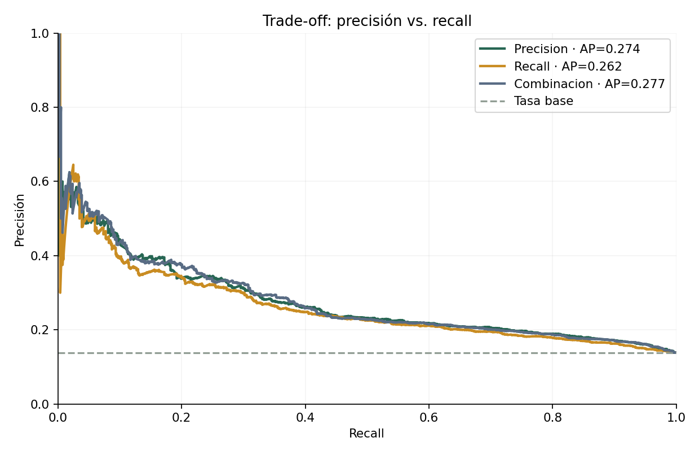
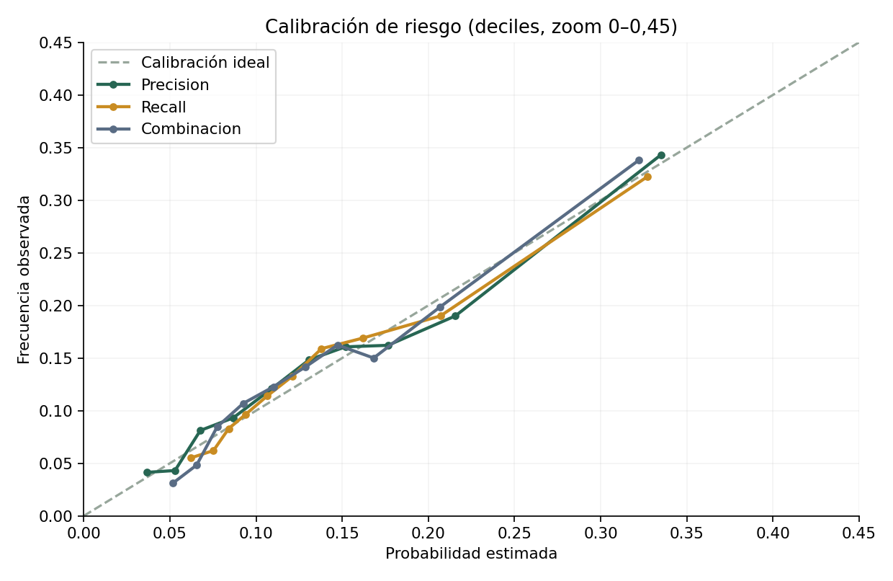
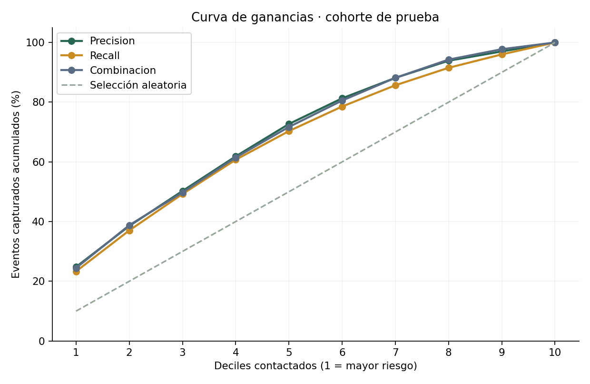
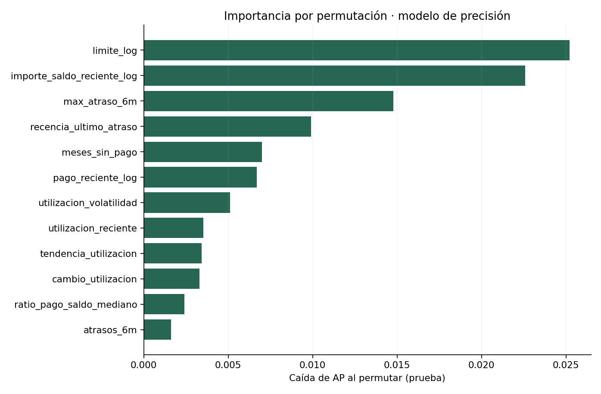

# Resultados reproducibles · cohorte preventiva

> ⚠️ **Datos públicos de UCI, no de clientes de Quórum Risk.** Estos números son de un ejercicio académico/demostrativo; no representan resultados comerciales.

Fuente: I-Cheng Yeh (2009), *Default of Credit Card Clients*, UCI Machine Learning Repository, https://doi.org/10.24432/C55S3H; **CC BY 4.0**.

## Población y etiqueta

- Fuente total: **30,000** filas.
- Sin atraso positivo registrado en septiembre de 2005: **23,182**.
- Excluidas por atraso positivo en septiembre: **6,818** (gestión correctiva, fuera de este demo).
- Resultado UCI para el mes siguiente: **3,207** eventos (**13.83%**).
- Observación abril–septiembre de 2005; desempeño en el **mes siguiente** según etiqueta original. Se trata de *default reportado*, no de una definición propia de 30/60/90 días de mora.
- El dataset tiene un único corte: **no permite prueba out-of-time**. Se utilizó separación estratificada y validación cruzada estratificada en desarrollo.

## Comparación final (holdout, no usada para ajustar umbrales)

| Estrategia | ROC AUC | PR AUC (AP) | KS | Precisión | Recall | F1 | Brier | Top decil lift | % contactado |
|---|---:|---:|---:|---:|---:|---:|---:|---:|---:|
| precision | 0.687 | 0.274 | 0.270 | 0.392 | 0.140 | 0.206 | 0.112 | 2.48× | 4.9% |
| recall | 0.667 | 0.262 | 0.243 | 0.213 | 0.570 | 0.310 | 0.113 | 2.33× | 37.0% |
| combinacion | 0.685 | 0.277 | 0.259 | 0.221 | 0.534 | 0.312 | 0.112 | 2.44× | 33.5% |

**Mayor PR AUC observada: `combinacion`**, AP=0.277. La diferencia con el siguiente método es **0.0023 puntos de AP**: demasiado pequeña para proclamar superioridad robusta sin intervalos de incertidumbre ni validación temporal. Tampoco implica que sea mejor en recall, precisión a un umbral o valor económico.

Los umbrales se seleccionaron usando predicciones *out-of-fold* del conjunto de desarrollo, con restricciones de cobertura/capacidad. La combinación es un promedio 50/50, evaluado como tercera hipótesis y **no se presupone mejor**.

## Visualizaciones

## Advertencias de interpretación

1. **No predice un nuevo atraso puro**: la etiqueta es default del mes siguiente tal como aparece en UCI. No se observan decisiones, contacto, pagos futuros intermedios ni fecha exacta de evento.
2. **La cohorte preventiva es una aproximación**: `PAY_0 <= 0` significa ausencia de código positivo de atraso, y los estados 0/-2 tienen ambigüedad semántica documentada.
3. Los ratios entre pagos y saldos son indicadores analíticos, **no conciliaciones contables**; pueden involucrar ciclos de facturación distintos.
4. La importancia por permutación muestra asociación predictiva, **no causalidad**. Las variables correlacionadas pueden repartirse la importancia.
5. Las probabilidades requieren examinar calibración, representatividad y efectos por grupos antes de cualquier uso real.
6. Una implementación real exige definición de target y exclusiones aprobada por negocio/riesgos; revisión de leakage; prueba temporal posterior; costos/capacidad; PSI/drift; monitoreo; recalibración; y gobernanza.

Reproducir: `pip install -r requirements.txt && python run_demo.py`.
